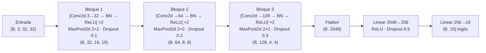
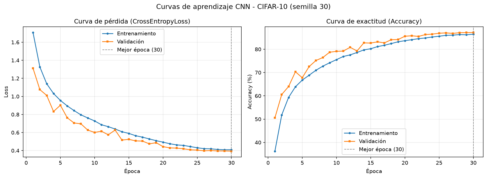
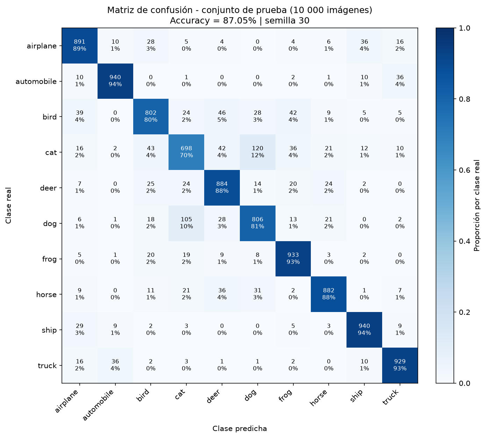

# Clasificación de imágenes CIFAR-10 mediante CNN, flujo de tensores 4D y análisis de métricas

**Universidad Andina del Cusco** · Departamento Académico de Ingeniería de Sistemas

**Evaluación de la Segunda Unidad · Inteligencia Artificial**

| Dato | Valor |
|---|---|
| Estudiante | Luidman Zanes |
| Semilla individual | **30** (`torch.manual_seed(30)` y `np.random.seed(30)`) |
| Dataset | CIFAR-10 (`torchvision.datasets.CIFAR10`): 60 000 imágenes RGB de 32×32 en 10 clases |
| Framework | PyTorch + torchvision |

---

## Estructura del repositorio

```
.
├── src/
│   ├── dataset.py            # Carga, transformaciones, partición y visualización (Pregunta 1)
│   ├── model.py              # Arquitectura CNN y validación de shapes 4D (Pregunta 3)
│   └── train.py              # Bucle de entrenamiento y evaluación (Pregunta 4)
│
├── notebooks/
│   └── experiment.ipynb      # Pruebas, EDA y visualización de muestras
│
├── outputs/
│   ├── loss_accuracy.png     # Curvas de aprendizaje (Pregunta 4)
│   └── confusion_matrix.png  # Matriz de confusión sobre el conjunto de prueba (Pregunta 4)
│
└── README.md                 # Documentación técnica, justificación teórica y análisis (Preguntas 2 y 4)
```

## Instalación y ejecución

```bash
pip install torch torchvision numpy matplotlib scikit-learn jupyter
```

```bash
python src/dataset.py      # descarga CIFAR-10, imprime la partición y muestra 16 imágenes con su clase
python src/model.py        # imprime la arquitectura y valida los shapes 4D con aserciones
python src/train.py        # entrena 30 épocas y genera outputs/loss_accuracy.png y outputs/confusion_matrix.png
jupyter notebook notebooks/experiment.ipynb
```

El dataset se descarga automáticamente en `data/` (excluido del repositorio con `.gitignore`).
`train.py` usa GPU CUDA, Apple MPS o CPU según disponibilidad.

### Uso de la semilla 30

La semilla individual se aplica en todos los puntos donde interviene el azar:

| Elemento aleatorio | Dónde se fija |
|---|---|
| `random`, `numpy`, `torch` (incluida la inicialización de pesos) | `set_seed(30)` en `src/dataset.py` |
| Asignación de imágenes a entrenamiento / validación | `train_test_split(..., stratify=targets, random_state=30)` |
| Orden de mezcla (shuffle) de cada época | `torch.Generator().manual_seed(30)` en el `DataLoader` |
| Aumentos de datos en los procesos del `DataLoader` | `worker_init_fn=seed_worker` |

---

## Pregunta 1 · Carga, visualización, transformaciones y partición

Implementado en [`src/dataset.py`](src/dataset.py) y reproducido en [`notebooks/experiment.ipynb`](notebooks/experiment.ipynb).

**1. Carga y semilla.** `load_cifar10()` descarga CIFAR-10 con `torchvision.datasets.CIFAR10`; `set_seed(30)` se ejecuta antes de cualquier operación aleatoria.

**2. Visualización.** `show_samples()` grafica una cuadrícula de 16 imágenes con su etiqueta real (nombre e índice de clase). La normalización se revierte con `denormalize()` para mostrar los colores originales.

**3. Pipeline de transformaciones (`torchvision.transforms`).**

| Conjunto | Transformaciones |
|---|---|
| Entrenamiento | `RandomCrop(32, padding=4)` → `RandomHorizontalFlip(p=0.5)` → `ToTensor()` → `Normalize(mean, std)` |
| Validación y prueba | `ToTensor()` → `Normalize(mean, std)` |

- `ToTensor()` convierte la imagen PIL `(H, W, C)` con valores 0–255 en un tensor `(C, H, W)` con valores en [0, 1].
- `Normalize` usa la media `(0.4914, 0.4822, 0.4465)` y la desviación estándar `(0.2470, 0.2435, 0.2616)` de cada canal RGB (verificadas en el EDA del notebook), dejando cada canal con media ≈ 0 y desviación ≈ 1.
- *Data augmentation*: `RandomCrop` con relleno de 4 píxeles desplaza el objeto hasta ±4 píxeles y `RandomHorizontalFlip` lo refleja. Solo se aplica al entrenamiento; la validación usa una copia del dataset sin aumento, de modo que se mide sobre imágenes reales.

**4. Partición estratificada.** El conjunto de entrenamiento original (50 000) se divide en 90 % / 10 % con `stratify`, conservando exactamente la proporción de cada clase. Salida de consola:

```
================================================================
Partición estratificada de CIFAR-10 (semilla = 30)
================================================================
Entrenamiento :  45000 imágenes | shape por imagen: (3, 32, 32)
Validación    :   5000 imágenes | shape por imagen: (3, 32, 32)
Prueba        :  10000 imágenes | shape por imagen: (3, 32, 32)
----------------------------------------------------------------
Distribución por clase (train / val / test):
  0 airplane     4500 /  500 / 1000
  1 automobile   4500 /  500 / 1000
  2 bird         4500 /  500 / 1000
  3 cat          4500 /  500 / 1000
  4 deer         4500 /  500 / 1000
  5 dog          4500 /  500 / 1000
  6 frog         4500 /  500 / 1000
  7 horse        4500 /  500 / 1000
  8 ship         4500 /  500 / 1000
  9 truck        4500 /  500 / 1000
----------------------------------------------------------------
Lote de entrenamiento (B, C, H, W): (128, 3, 32, 32) | etiquetas: (128,)
================================================================
```

| Subconjunto | Imágenes | Por clase | Uso |
|---|---:|---:|---|
| Entrenamiento | 45 000 | 4 500 | Ajuste de pesos (con *data augmentation*) |
| Validación | 5 000 | 500 | Selección de la mejor época y diagnóstico de overfitting |
| Prueba | 10 000 | 1 000 | Evaluación final independiente (no se usa durante el entrenamiento) |

---

## Pregunta 2 · Justificación estructural de la CNN frente a un MLP

### 2.1 Por qué un Perceptrón Multicapa (MLP) colapsa o es ineficiente con CIFAR-10

Un MLP solo acepta vectores, por lo que cada imagen de `3 × 32 × 32` debe aplanarse en un vector de **3 072** valores. Esto provoca cuatro problemas:

1. **Pérdida de la estructura espacial.** Al aplanar, el píxel (10, 10) y su vecino (10, 11) quedan como dos entradas independientes; la red no sabe que son vecinos ni que los tres canales RGB de un píxel están relacionados. La vecindad 2D, que es la información más importante de una imagen, tiene que reaprenderse desde cero a partir de los datos.
2. **Explosión de parámetros (conexión total).** Cada neurona oculta se conecta con los 3 072 píxeles. Una sola capa de 1 024 neuronas ya requiere `3 072 × 1 024 + 1 024 = 3 146 752` parámetros, y un MLP modesto `3072 → 1024 → 512 → 10` suma **3 676 682** parámetros, **4,5 veces más** que la CNN completa de este proyecto (815 018). El problema empeora con la resolución: con imágenes de 224×224×3 (150 528 entradas) esa misma primera capa tendría más de 154 millones de pesos.
3. **Sin invariancia a la traslación.** Si un gato se mueve 4 píxeles a la derecha, en el MLP se activan pesos completamente distintos. El detector de "oreja" tiene que aprenderse por separado en cada posición posible de la imagen, lo que exige muchísimos más ejemplos de los que ofrece CIFAR-10 (5 000 por clase).
4. **Sobreajuste y optimización difícil.** Con millones de parámetros y pocos datos, el MLP tiende a memorizar valores de píxeles en lugar de patrones visuales. En la práctica, los MLP sobre CIFAR-10 se estancan alrededor de 50–55 % de exactitud en prueba, mientras que una CNN pequeña supera holgadamente el 80 %.

### 2.2 Cómo lo resuelven las propiedades de las CNN

| Propiedad | Mecanismo | Efecto en CIFAR-10 |
|---|---|---|
| **Conexiones locales** (campo receptivo local) | Cada neurona de un `Conv2d` 3×3 solo mira una ventana de 3×3 píxeles × canales de entrada. | Aprovecha que los píxeles cercanos están correlacionados. Las capas apiladas forman una jerarquía: bordes → texturas → partes → objetos. En esta red el campo receptivo crece a 3, 5, 6, 10, 14, 16, 24, 32 y 36 píxeles, por lo que cada neurona del último bloque "ve" la imagen completa de 32×32. |
| **Weight sharing** (pesos compartidos) | El mismo filtro (por ejemplo 3×3×3 = 27 pesos + 1 sesgo) se desliza por las 32×32 posiciones. | La primera convolución produce un mapa de `32×32×32` con solo **896** parámetros; una capa densa que produjera esa misma salida necesitaría `3 072 × 32 768 ≈ 100,7 millones` de pesos. Menos parámetros implica menos sobreajuste y menos memoria. |
| **Invariancia espacial** | La convolución es *equivariante* a la traslación (si el objeto se desplaza, el mapa de activación se desplaza igual) y `MaxPool2d` resume cada región 2×2 con su máximo, aportando invariancia local a pequeños desplazamientos. | Un detector aprendido en una posición sirve en todas las demás. Junto con `RandomCrop` y `RandomHorizontalFlip`, la red reconoce el objeto aunque cambie de posición u orientación horizontal. |

En resumen, la CNN introduce un **sesgo inductivo** adecuado para imágenes (localidad + estacionariedad de los patrones), lo que reduce drásticamente los parámetros y mejora la generalización.

### 2.3 Especificación de la arquitectura

La red tiene **3 bloques convolucionales** (el enunciado exige mínimo 2), cada uno con `Conv2d`, `ReLU` y `MaxPool2d`, seguidos de capas `Linear` hacia las 10 clases.



| Etapa | Capa | Configuración | Salida `(B, C, H, W)` | Parámetros |
|---|---|---|---|---:|
| Entrada | — | imagen RGB normalizada | `(B, 3, 32, 32)` | 0 |
| **Bloque 1** | Conv2d | 3→32, kernel 3×3, stride 1, padding 1 | `(B, 32, 32, 32)` | 896 |
| | BatchNorm2d + ReLU | 32 canales | `(B, 32, 32, 32)` | 64 |
| | Conv2d | 32→32, kernel 3×3, padding 1 | `(B, 32, 32, 32)` | 9 248 |
| | BatchNorm2d + ReLU | 32 canales | `(B, 32, 32, 32)` | 64 |
| | MaxPool2d + Dropout | kernel 2×2, stride 2 · p = 0.1 | `(B, 32, 16, 16)` | 0 |
| **Bloque 2** | Conv2d | 32→64, kernel 3×3, padding 1 | `(B, 64, 16, 16)` | 18 496 |
| | BatchNorm2d + ReLU | 64 canales | `(B, 64, 16, 16)` | 128 |
| | Conv2d | 64→64, kernel 3×3, padding 1 | `(B, 64, 16, 16)` | 36 928 |
| | BatchNorm2d + ReLU | 64 canales | `(B, 64, 16, 16)` | 128 |
| | MaxPool2d + Dropout | kernel 2×2, stride 2 · p = 0.2 | `(B, 64, 8, 8)` | 0 |
| **Bloque 3** | Conv2d | 64→128, kernel 3×3, padding 1 | `(B, 128, 8, 8)` | 73 856 |
| | BatchNorm2d + ReLU | 128 canales | `(B, 128, 8, 8)` | 256 |
| | Conv2d | 128→128, kernel 3×3, padding 1 | `(B, 128, 8, 8)` | 147 584 |
| | BatchNorm2d + ReLU | 128 canales | `(B, 128, 8, 8)` | 256 |
| | MaxPool2d + Dropout | kernel 2×2, stride 2 · p = 0.3 | `(B, 128, 4, 4)` | 0 |
| **Clasificador** | Flatten | 128 × 4 × 4 | `(B, 2048)` | 0 |
| | Linear + ReLU + Dropout | 2048→256 · p = 0.5 | `(B, 256)` | 524 544 |
| | Linear | 256→10 (logits) | `(B, 10)` | 2 570 |
| | | | **Total** | **815 018** |

**Cálculo de dimensiones.** Para una convolución o pooling: `H_out = ⌊(H_in + 2·padding − kernel) / stride⌋ + 1`.

- `Conv2d` 3×3 con `padding=1`, `stride=1`: `(32 + 2 − 3)/1 + 1 = 32` → conserva H y W.
- `MaxPool2d` 2×2 con `stride=2`: `(32 − 2)/2 + 1 = 16` → reduce H y W a la mitad.
- Tras tres bloques: `32 → 16 → 8 → 4`, mientras los canales crecen `3 → 32 → 64 → 128`. Por eso la entrada de la primera capa densa es `128 × 4 × 4 = 2048`.

**Decisiones de diseño.**

- **Dos convoluciones 3×3 por bloque** (estilo VGG): cubren un campo receptivo de 5×5 con menos parámetros que una sola convolución 5×5 (`2·9·C²` frente a `25·C²`) y añaden una no linealidad extra.
- **Duplicar canales al reducir la resolución** mantiene la capacidad de representación mientras el mapa espacial se achica.
- **BatchNorm2d** estabiliza la distribución de activaciones y acelera la convergencia con Adam.
- **Dropout progresivo** (0.1 → 0.2 → 0.3 → 0.5) regulariza más donde hay más parámetros (la capa densa concentra el 64 % del total).
- La salida son **logits** sin `Softmax`, porque `CrossEntropyLoss` ya aplica `LogSoftmax` internamente.

---

## Pregunta 3 · Manipulación de tensores 4D y validación del forward pass

Implementado en [`src/model.py`](src/model.py).

1. **Definición del modelo.** La clase `CIFAR10CNN(nn.Module)` define los bloques en `__init__` y el flujo en `forward()`. Con `forward(x, verbose=True)` se imprime el shape después de cada etapa.
2. **Conexión entre bloques convolucionales y capas densas.** Se usan las dos alternativas:
   - una capa `nn.Flatten()` que convierte `(B, 128, 4, 4)` en `(B, 2048)`;
   - un **cálculo dinámico** del tamaño (`_get_flatten_dim`): en el constructor se pasa un tensor ficticio `torch.zeros(1, 3, 32, 32)` por los bloques convolucionales y se mide la salida. Así `fc1.in_features` nunca queda escrito a mano y no puede producirse un *Shape Mismatch* si se cambia la arquitectura.
3. **Validación con aserciones.** `validate_shapes()` pasa un lote simulado `torch.randn(8, 3, 32, 32)`, imprime los shapes intermedios y verifica con `assert` cada etapa, que `fc1.in_features` coincida con el Flatten y que la salida no contenga `NaN`/`Inf`. Salida de `python src/model.py`:

```
Tamaño dinámico de Flatten: 2048 (= 128 x 4 x 4)
Parámetros entrenables: 815,018

Validación del forward pass con un lote simulado de shape (8, 3, 32, 32)
  Entrada                     -> (8, 3, 32, 32)
  Bloque conv 1               -> (8, 32, 16, 16)
  Bloque conv 2               -> (8, 64, 8, 8)
  Bloque conv 3               -> (8, 128, 4, 4)
  Flatten                     -> (8, 2048)
  Linear 1 + ReLU + Dropout   -> (8, 256)
  Linear 2 (logits)           -> (8, 10)
OK: la arquitectura procesa tensores 4D sin errores -> salida (8, 10)
```

El tensor mantiene siempre el formato 4D `(Batch, Channels, Height, Width)` dentro de los bloques convolucionales: el tamaño de lote `B` nunca cambia, los canales crecen (3 → 32 → 64 → 128) y la resolución espacial se reduce a la mitad en cada `MaxPool2d` (32 → 16 → 8 → 4). Solo en `Flatten` el tensor pasa a 2D `(B, 2048)`, que es el formato que espera `nn.Linear`. La misma validación se repite en el notebook con un lote real de 128 imágenes del `DataLoader`.

---

## Pregunta 4 · Entrenamiento, métricas y curvas de aprendizaje

Implementado en [`src/train.py`](src/train.py).

### 4.1 Configuración del entrenamiento

| Hiperparámetro | Valor | Justificación |
|---|---|---|
| Función de pérdida | `nn.CrossEntropyLoss()` | Clasificación multiclase; combina `LogSoftmax` + `NLLLoss` sobre los logits. Pérdida inicial esperada ≈ ln(10) = 2,30. |
| Optimizador | `optim.Adam(lr=1e-3, weight_decay=1e-4)` | Tasa de aprendizaje adaptativa por parámetro con momento; converge rápido sin ajuste fino. `weight_decay` añade regularización L2. |
| Planificador de LR | `CosineAnnealingLR(T_max=30)` | Reduce la tasa de aprendizaje de 1e-3 a ≈ 0 siguiendo un coseno para afinar los pesos en las últimas épocas. |
| Épocas | 30 | 352 iteraciones por época (45 000 / 128). |
| Tamaño de lote | 128 | Tensores de entrada `(128, 3, 32, 32)`. |
| Selección del modelo | Mejor *accuracy* de validación | Los pesos de esa época se usan para evaluar el conjunto de prueba. |
| Hardware | GPU Apple (MPS) | ≈ 4,7 s por época, ≈ 2,5 min en total. |

### 4.2 Bucle de entrenamiento

```python
for epoch in range(EPOCHS):
    train_loss, train_acc = train_one_epoch(model, train_loader, criterion, optimizer, device)
    val_loss, val_acc = evaluate(model, val_loader, criterion, device)
    scheduler.step()
    history["train_loss"].append(train_loss); history["train_acc"].append(train_acc)
    history["val_loss"].append(val_loss);     history["val_acc"].append(val_acc)
```

- `train_one_epoch`: `model.train()` → `optimizer.zero_grad()` → forward → `CrossEntropyLoss` → `loss.backward()` → `optimizer.step()`, acumulando Loss y Accuracy.
- `evaluate`: `model.eval()` + `torch.no_grad()` (sin Dropout, BatchNorm con estadísticas fijas y sin gradientes).
- Al terminar se evalúa el conjunto de prueba, se imprime el reporte de clasificación y se guardan `outputs/loss_accuracy.png` y `outputs/confusion_matrix.png`.

### 4.3 Resultados con la semilla 30

**Evolución por épocas** (registro completo en la salida de `python src/train.py`):

| Época | Train Loss | Train Acc | Val Loss | Val Acc |
|---:|---:|---:|---:|---:|
| 1 | 1,7073 | 36,26 % | 1,3120 | 50,56 % |
| 5 | 0,9555 | 66,75 % | 0,9023 | 67,78 % |
| 10 | 0,7286 | 75,54 % | 0,6010 | 79,10 % |
| 15 | 0,5903 | 80,21 % | 0,5245 | 82,64 % |
| 20 | 0,4936 | 83,67 % | 0,4438 | 85,58 % |
| 25 | 0,4311 | 85,58 % | 0,4051 | 86,86 % |
| **30** | **0,4097** | **86,45 %** | **0,3939** | **87,16 %** |

**Métricas finales** (pesos de la mejor época de validación, época 30):

| Conjunto | Loss | Accuracy |
|---|---:|---:|
| Entrenamiento, medido en el bucle (con *data augmentation* y Dropout activos) | 0,4097 | 86,45 % |
| Entrenamiento, modo eval (mismas 45 000 imágenes sin aumento ni Dropout) | 0,2695 | 90,64 % |
| Validación (5 000) | 0,3939 | 87,16 % |
| **Prueba (10 000, independiente)** | **0,3916** | **87,05 %** |

F1 macro en prueba: **0,8696**. Errores totales en prueba: 1 295 de 10 000.





**Métricas por clase en prueba:**

| Clase | Precision | Recall | F1-score |
|---|---:|---:|---:|
| airplane | 0,8667 | 0,8910 | 0,8787 |
| automobile | 0,9409 | 0,9400 | **0,9405** |
| bird | 0,8433 | 0,8020 | 0,8221 |
| cat | 0,7730 | 0,6980 | *0,7336* |
| deer | 0,8419 | 0,8840 | 0,8624 |
| dog | 0,7996 | 0,8060 | 0,8028 |
| frog | 0,8810 | 0,9330 | 0,9063 |
| horse | 0,9093 | 0,8820 | 0,8954 |
| ship | 0,9234 | 0,9400 | 0,9316 |
| truck | 0,9162 | 0,9290 | 0,9225 |

**Reproducibilidad:** dos ejecuciones independientes de `python src/train.py` con la semilla 30 produjeron métricas idénticas en las 30 épocas. En otro hardware (CUDA o CPU) pueden aparecer variaciones mínimas por diferencias de punto flotante.

### 4.4 Análisis crítico: ¿overfitting o underfitting?

**1. No hay síntomas de overfitting.**

- **La pérdida de validación no sube.** Baja de 1,3120 a 0,3939 (−70,0 %) y alcanza su mínimo en la última época. No aparece la forma de "U" típica del sobreajuste (Val Loss subiendo mientras Train Loss sigue bajando). Por eso la mejor época según validación es la 30.
- **La brecha de generalización es pequeña.** Si se comparan en igualdad de condiciones (modo eval), el modelo obtiene 90,64 % en entrenamiento frente a 87,05 % en prueba: una brecha de **+3,59 puntos porcentuales**, con pérdidas de 0,2695 frente a 0,3916. Un modelo sobreajustado mostraría ~99 % en entrenamiento y una brecha superior a 10 pp.
- **Validación por encima de entrenamiento durante el bucle** (87,16 % frente a 86,45 %; −0,71 pp). No es una anomalía: durante el entrenamiento la red trabaja con Dropout (hasta p = 0,5) y con imágenes aumentadas (recortes y volteos), es decir, sobre datos más difíciles y con una red reducida. En validación ambos mecanismos están desactivados.
- **Validación y prueba coinciden** (87,16 % frente a 87,05 %, diferencia de 0,11 pp). La partición estratificada produjo un conjunto de validación representativo, y seleccionar la mejor época con él no sobreajustó a la validación.

**2. Hay una ligera tendencia a underfitting (sesgo moderado, varianza baja).**

- El modelo no memoriza el conjunto de entrenamiento: llega a 90,64 % (no ~100 %), con una pérdida de 0,27 todavía apreciable. La regularización combinada (Dropout, `weight_decay` y aumento de datos) limita la capacidad de ajuste.
- Las curvas siguen subiendo al final. La ganancia en Val Acc fue de +28,54 pp entre las épocas 1 y 10, de +6,48 pp entre la 10 y la 20, y de +1,58 pp entre la 20 y la 30. Esa meseta final coincide con la tasa de aprendizaje llegando a ≈ 0 por el planificador coseno, no con una saturación de la capacidad del modelo.
- No es un underfitting severo: 87,05 % está muy por encima del azar (10 %) y del rango típico de un MLP (~50–55 %). Pero el modelo todavía tiene margen de mejora.

**Diagnóstico:** el modelo presenta un **buen ajuste**, sin overfitting y con una leve tendencia a underfitting. La brecha entre entrenamiento y prueba es de 3,59 pp y las curvas no se separan.

**3. Análisis de errores por clase (matriz de confusión).**

- **Gato ↔ perro** es la confusión dominante: 120 gatos clasificados como perro y 105 perros como gato, en total 225 errores (**17,4 % de los 1 295 errores**). `cat` es la clase más difícil (recall 69,8 %, F1 0,734). A 32×32 píxeles ambos animales comparten textura de pelaje, siluetas y fondos domésticos.
- **bird** (F1 0,822) se confunde con `deer` (46), `frog` (42) y `airplane` (39): siluetas pequeñas sobre fondos naturales o cielo.
- **Confusiones semánticas razonables:** `automobile` ↔ `truck` (36 + 36 = 72) y `airplane` ↔ `ship` (36 + 29 = 65), por fondos uniformes de cielo o mar.
- **Mejores clases:** `automobile` (F1 0,941), `ship` (0,932), `truck` (0,923) y `frog` (0,906), con formas y colores más distintivos.

**4. Propuestas de mejora** (para reducir el sesgo sin provocar overfitting):

1. Entrenar más épocas (50–60), ya que las curvas no se saturaron.
2. Aumentar la capacidad: más filtros (64-128-256) o conexiones residuales (ResNet).
3. Reducir el Dropout de la capa densa (0,5 → 0,3), dado que la brecha de generalización es baja.
4. Usar aumentos de datos más específicos (`ColorJitter`, *Cutout*) para separar mejor gato y perro.

---

## Notebook de experimentación

[`notebooks/experiment.ipynb`](notebooks/experiment.ipynb) se ejecutó completo y guarda sus salidas:

1. **Carga** de CIFAR-10 con la semilla 30 (50 000 + 10 000 imágenes, datos crudos `(50000, 32, 32, 3) uint8`).
2. **EDA:** distribución de clases (balanceada: 5 000 por clase en entrenamiento y 1 000 en prueba), media y desviación de cada canal RGB e histogramas de intensidad.
3. **Visualización** de 16 imágenes con su etiqueta real.
4. **Data augmentation:** una imagen original y 7 versiones aumentadas. Se verifica que tras normalizar cada canal tiene media ≈ 0 y desviación ≈ 1.
5. **Partición estratificada** 45 000 / 5 000 (4 500 / 500 por clase) con gráfico de proporciones y aserción.
6. **Validación de shapes 4D** con un lote simulado y con un lote real de 128 imágenes.
7. **Prueba de sanidad:** la red sobreajusta a propósito un lote de 32 imágenes. La pérdida pasa de 2,3605 (≈ ln 10) a 0,0095 y alcanza 100 % de exactitud en ese lote, lo que confirma que modelo, pérdida y optimizador están bien conectados.
8. **Resultados:** se muestran las gráficas de `outputs/`.
